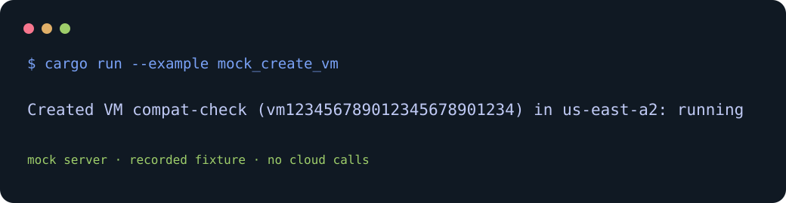

# ubicloud-rs

[](LICENSE)

Rust client for the Ubicloud Clover API. Use it as a **tagged Git dependency**; it is not published to crates.io.



## API source and generation

The vendored source is [`spec/openapi.yml`](spec/openapi.yml), fetched from the official [`ubicloud/ubicloud` repository](https://github.com/ubicloud/ubicloud) at revision `00f2bfa6236d3c3a715de4ee59437cdc966f0f8f` (2026-10-17). SHA-256: `52d97f23dafe311fcb41ba5376babcad43d01ee19a83804487827e8a6818c30a`. The current revision, hash and Progenitor pin are recorded in `[package.metadata.upstream-spec]` in `Cargo.toml`. The client is generated with `oxidecomputer/progenitor` pinned to `23accc9f63cf3a56ac697ba92ac3d176c940dbdb` (v0.15.1). The `tools/generate` helper crate (Rust, unit-tested) applies a deterministic compatibility transformation to `default` responses: Progenitor cannot model an explicit success response together with OpenAPI `default`, so each shared Ubicloud error response is represented as the `4XX` and `5XX` ranges during generation. The official vendored source remains unchanged. Regenerate with `scripts/generate-client.sh`, which also adds the `clippy::result_large_err` allowance to the generated module and normalizes it with edition-2024 `rustfmt`. Generation requires Rust nightly `rustfmt` (set `RUSTFMT` to pin one) because Progenitor uses rustfmt's unstable formatting options.

The generated API covers projects, virtual machines, private subnets, firewalls and locations. The generated async client is exposed with a blocking shim using one shared Tokio runtime. The shim retries retry-safe operations on HTTP 429 and 5xx responses with bounded exponential backoff. Credentials use redacted secret wrappers; do not enable HTTP wire logging in applications that may expose Authorization headers.

### Scheduled regeneration

`scripts/regen` runs standalone on a Linux host and does not use GitLab CI minutes. It resolves upstream `main`, fetches the spec at that revision, and exits if the SHA-256 matches the vendored hash. Otherwise it regenerates with the pinned Progenitor, runs `cargo fmt --check`, Clippy, tests and rustdoc, and picks the release with `cargo-semver-checks` against the latest `v*` tag: minor for additive changes, major for breaking changes, patch when only the spec text changed. It then commits to `main`, tags `v<semver>+api.<upstream revision>` and pushes both. Failures print the failing step and exit nonzero; when `GITLAB_TOKEN` is set and `glab` is installed, a GitLab issue is opened too. `scripts/regen --dry-run` skips the commit, tag and push and leaves the regenerated files in the working tree. Example systemd units are in [`contrib/systemd`](contrib/systemd). GitLab CI only runs fmt, Clippy and tests. Nothing is published to crates.io.

## Licensing

Code in this repository is licensed under GNU GPL version 3 or any later
version; see [LICENSE](LICENSE). The vendored `spec/openapi.yml` originates
from the AGPL-3.0-licensed Ubicloud repository, and the upstream specification
notice is preserved in [NOTICE](NOTICE). GPL-3.0 section 13 permits combining
a covered work with a work licensed under AGPL-3.0; see the
[GNU GPL section 13 text](https://www.gnu.org/licenses/gpl-3.0.html#section13).

## Install

```toml
[dependencies]
ubicloud-rs = { git = "https://github.com/davidawad/ubicloud-rs", tag = "v0.1.0+api.00f2bfa6236d3c3a715de4ee59437cdc966f0f8f" }
```

Tags have the form `v<ver>+api.<rev>`: `<ver>` is the crate's semantic version and `<rev>` is the full Ubicloud API revision the client was generated from. `scripts/regen` selects the next semantic version and updates Cargo.toml to match the new tag before it commits. Never move or recreate a tag; each regeneration release gets a new tag.

Use the async generated `Client` for async applications, or `blocking::Client` for synchronous callers. Configure authentication with `Secret` so its `Debug` output is always redacted. The blocking client exposes the generated client through `async_client()` and runs an operation with `run(|| client.async_client().get_project(&project_id))`; it shares one Tokio runtime and retries status 429 and all 5xx responses with bounded exponential backoff. Retryable operations should be safe to replay.

### Mock create example

Run the checked-in example against its local mock HTTP server:

```sh
cargo run --example mock_create_vm
```

```text
Created VM compat-check (vm123456789012345678901234) in us-east-a2: running
```

The mock response is recorded in [`fixtures/create-vm-response.json`](fixtures/create-vm-response.json); this example makes no cloud API calls.

## Validation

CI runs formatting, Clippy with warnings denied, and unit tests against recorded fixtures (no live API calls); the `tools/generate` crate has its own unit tests. `scripts/regen` additionally checks rustdoc before releasing.
